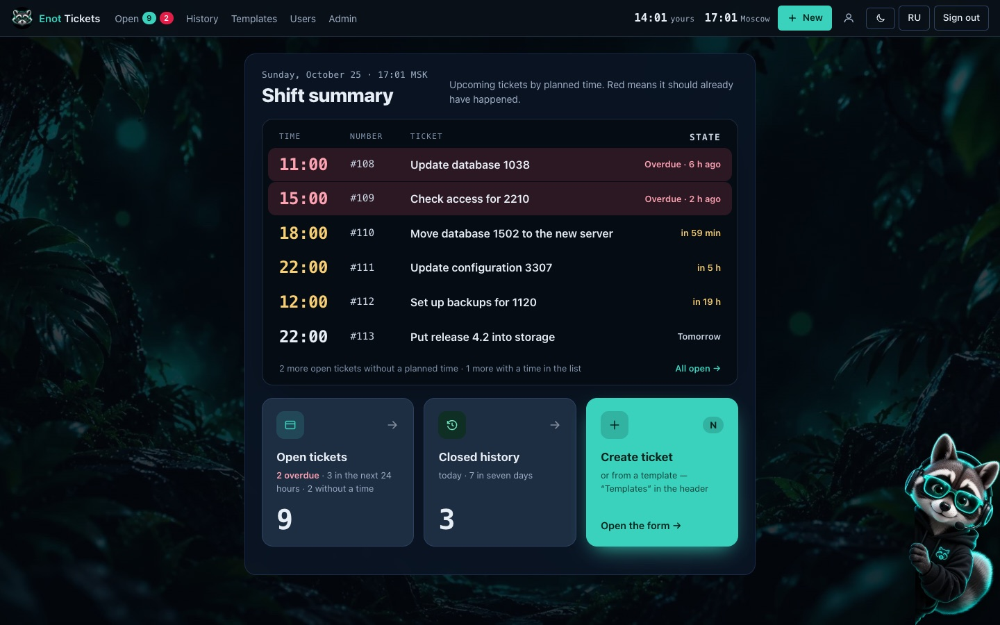
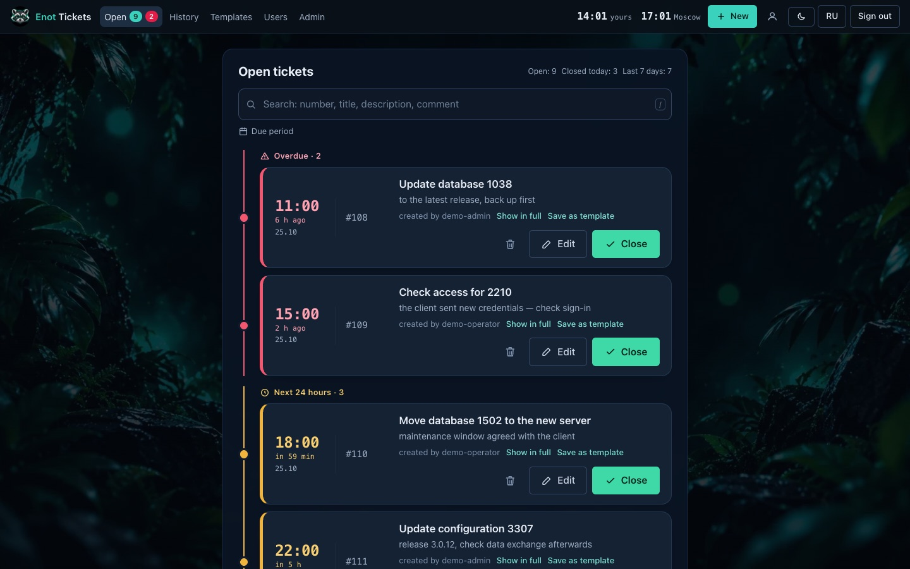
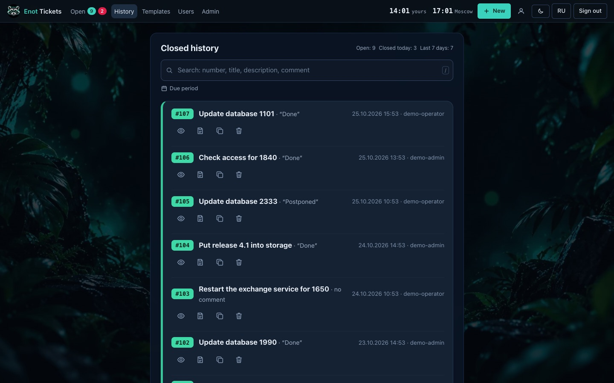
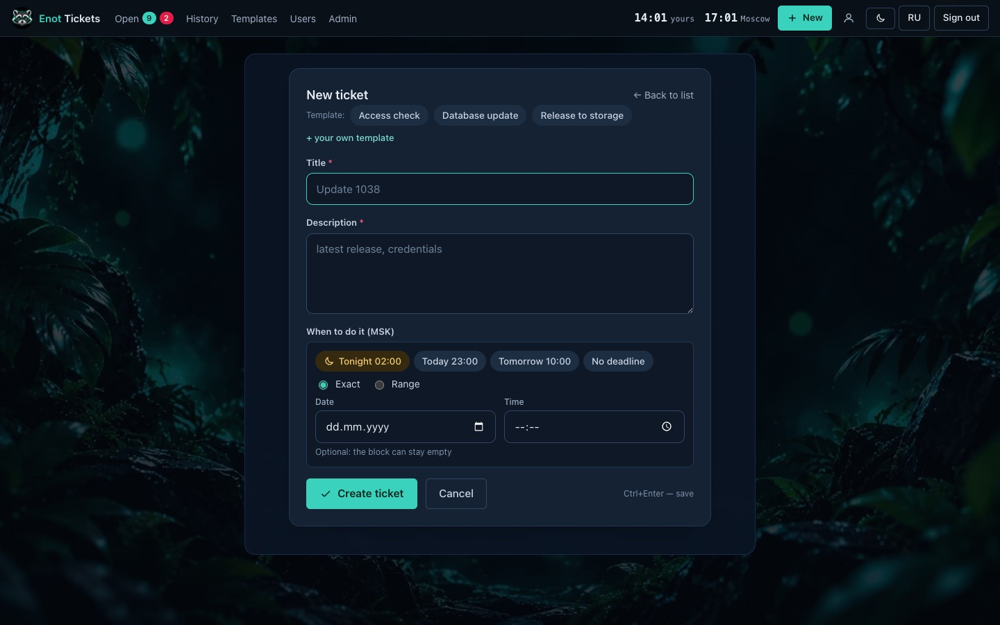
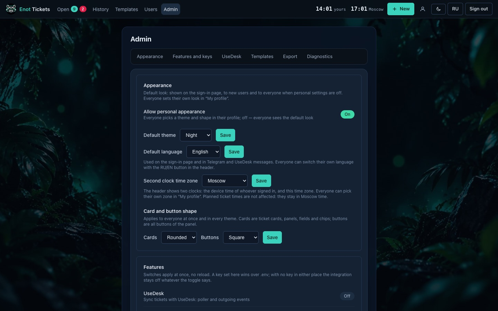
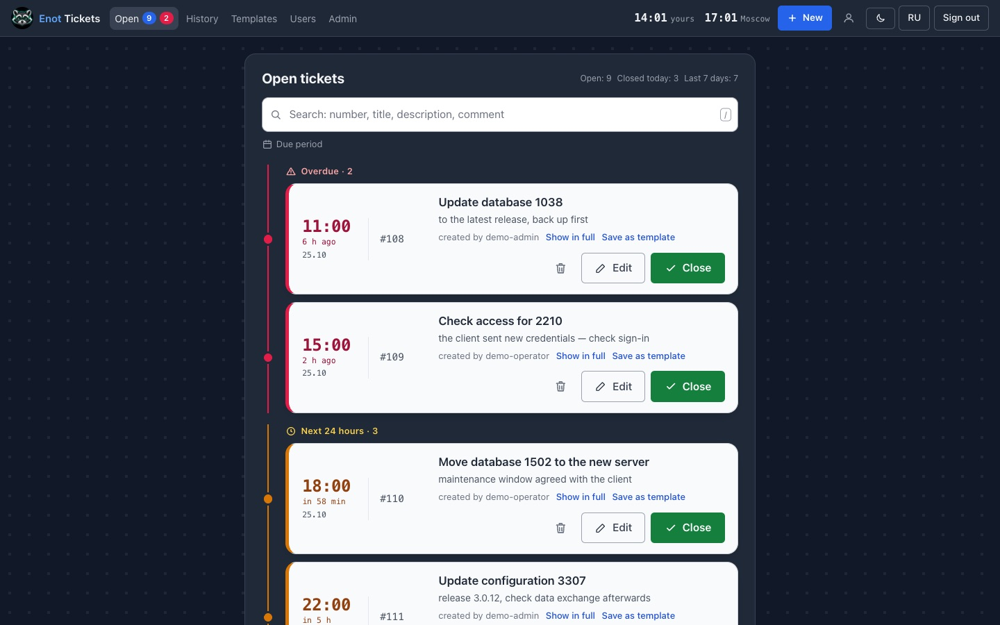
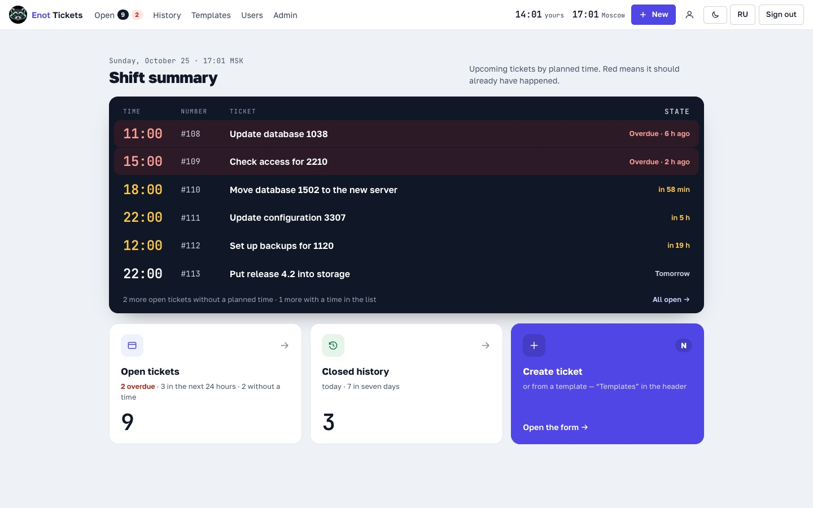
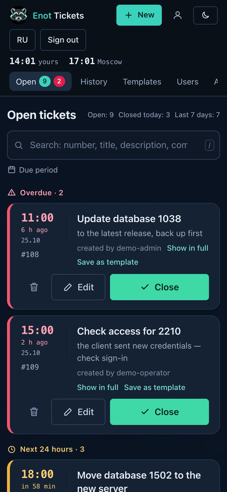
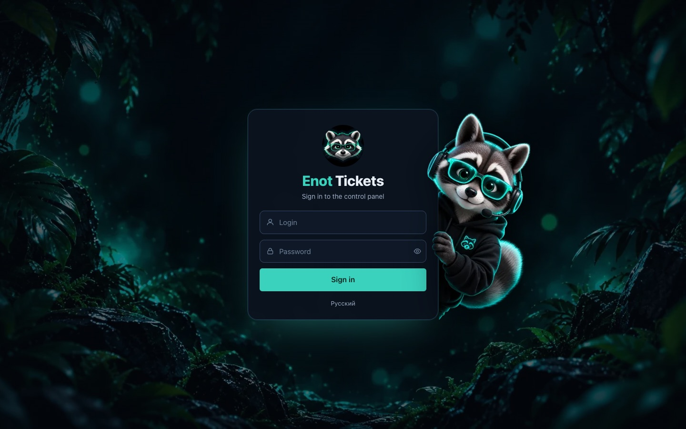

# Enot Tickets: a simple self-hosted ticket panel for support teams

[Русский](README.md) · **English**

Enot Tickets (Тикеты Енот, "enot" is Russian for raccoon) is a small web panel for tickets that you run on your own server. I built it for a support team that updates client databases: an operator files a ticket with a deadline, the panel shows what is overdue and what is due within a day, and a closed ticket moves to history with a comment. New and closed tickets are posted to a Telegram group, and tickets sync both ways with the [UseDesk](https://usedesk.ru) helpdesk.

It runs on Python (FastAPI), Jinja2 templates with HTMX, and a single SQLite database. No Node.js, no frontend build step, no separate database server. The interface is in Russian and English, switched with an RU/EN button.



## Features

- The home page is a shift summary: a board of upcoming tickets by planned time with overdue ones on top, plus counters for open, overdue and closed today.
- Open tickets are grouped by deadline: Overdue, Next 24 hours, Later, No deadline. Each row starts with the time in large digits and a hint under it like "in 2 h" or "5 h ago".
- Closing takes two clicks: "Done" and "Postponed" chips or your own comment.
- Closed ticket history with search by number, title, description and comment.
- Templates for routine tickets, personal or shared. A placeholder in braces such as `{database}` gets selected after a click, so you type the number right over it.
- Admin and operator roles, password change in the profile, user deactivation.
- Three themes, Night, Classic and Board, with rounded or square buttons. Two clocks in the header: the device time and a chosen time zone (the admin sets it for everyone, the profile can override). Everyone has their own look, stored on the server and the same on every device. You can make [your own theme](docs/themes.en.md).
- A Telegram bot posts new and closed tickets to a group.
- UseDesk sync: a ticket created in the panel opens a UseDesk ticket, a UseDesk ticket becomes a panel ticket, and closing works both ways.
- Export to CSV (opens in Excel) and JSON, import of an existing ticket list from JSON.
- Works on phones, tablets and large monitors. Hotkeys: `/` search, `N` new ticket, `Ctrl+Enter` save.

## Screenshots

| Open tickets | Closed history |
|---|---|
|  |  |
| **New ticket with templates** | **Admin** |
|  |  |
| **Classic theme** | **Board theme** |
|  |  |
| **Phone** | **Sign-in** |
|  |  |

The header in the screenshots shows two clocks: the device time (the browser was set to London) and Moscow. All tickets are made up; `scripts/demo_data.py` creates them.

## The honest part: what this version is and is not

The panel was written for one small team and does that job: 363 automated tests pass, and the integrations are tested against mocks. It is not Jira or Zendesk, though, and you should know its limits before you install it.

- **Deadlines run on Moscow time (UTC+3).** The time zone setting only changes the second clock in the header. Planned time, "overdue", "today" and history timestamps still use MSK; counting them in another zone means changing the code (`app/tickets.py`, `static/app.js`).
- **One process, one SQLite file.** Fine for a team of up to a few dozen people. It does not scale horizontally: never run two instances against one database ([ADR-0001](docs/adr/0001-sqlite-single-process.md), in Russian).
- **A ticket is either open or closed.** There is no assignee, priority, attachments, in-ticket conversation, SLA or reporting.
- **Integrations are UseDesk and Telegram only.** No email. UseDesk is polled once a minute rather than via webhooks, so changes can take up to a minute to arrive ([ADR-0002](docs/adr/0002-polling-not-webhooks.md)).
- **Sign-in is login and password only.** No two-factor auth and no SSO. The failed-login counter lives in memory and resets on restart.
- **No API.** People use the panel in a browser; other systems can only pull data through CSV/JSON export.
- **The translation has gaps at the edges.** The whole UI is translated, but server logs, code comments and developer docs (`docs/architecture.md`, ADRs, `INSTALL.md`) are in Russian. Search handles word endings for Russian only; English search matches substrings.
- **A theme id lives in several places.** Adding another theme means registering its id in five files ([how to](docs/themes.en.md)).
- **Backups are manual:** copy the `data/` folder. The panel does not back itself up on a schedule.
- **If the only admin forgets the password,** the only way back in is restoring from a backup.

### What happens next

The project is no longer developed; this is the final version. The code is under the [MIT license](LICENSE): if the panel lacks something, take it as a starting point and build what you need. Change it and use it however you like, commercial projects included, as long as you keep the license file. See [For developers](#for-developers) for where to start.

## Try it with demo data

You need [uv](https://docs.astral.sh/uv/), the Python package manager. The script creates a separate database with made-up tickets, the users `demo-admin` and `demo-operator`, and prints their password:

```bash
uv sync
DB_PATH=data/demo.sqlite uv run python scripts/demo_data.py --lang en
```

```bash
DB_PATH=data/demo.sqlite uv run uvicorn app.main:app --port 8072
```

Open <http://127.0.0.1:8072> and sign in as `demo-admin`. The script never touches a real database: if the database already has tickets, it refuses to run.

## Language

The RU/EN button is in the header, on the home page and on the sign-in page. The choice is remembered in the browser and, for a signed-in user, in the profile, so the language follows the user to another device after sign-in. The admin picks the language of the sign-in page and of Telegram and UseDesk messages: **Admin → Appearance → Default language**.

UI strings are written in Russian inside `_()` in the code; the English translation is `app/locales/en.json`. `tests/test_i18n.py` checks that every string has a translation and that no Russian text is left on English pages.

## Custom themes

How to recolor Night, Classic or Board and how to add a new theme: [docs/themes.en.md](docs/themes.en.md).

## Quick start with Docker

You need Docker ([Docker Desktop](https://www.docker.com/products/docker-desktop/), or `brew install colima docker && colima start` on a Mac).

1. Create the settings file:

   ```bash
   cp .env.example .env
   ```

2. In `.env`, set the first administrator and a session key:

   ```
   ADMIN_LOGIN=admin
   ADMIN_PASSWORD=choose-a-strong-password
   PANEL_SECRET_KEY=<output of: openssl rand -base64 32>
   ```

   The password can be at most 72 bytes (a bcrypt limit). With a longer one the panel still starts, but no admin is created and the log explains why.

3. Build and start:

   ```bash
   docker compose up --build -d
   ```

4. Open <http://127.0.0.1:8072> and sign in. The port listens only on your machine; the panel is not reachable from the internet until you publish it yourself.

Everything works without the other keys: with no tokens, the integrations simply stay off.

There is also a one-command installer that picks Docker or a native run on its own: `bash scripts/install.sh`. With `DOMAIN=tickets.example.com bash scripts/install.sh` it also sets up Caddy with a Let's Encrypt certificate. Details are in [INSTALL.md](INSTALL.md) (in Russian).

## Settings (`.env`)

| Key | What it is |
|---|---|
| `ADMIN_LOGIN`, `ADMIN_PASSWORD` | First administrator; created once, while the user table is empty |
| `PANEL_SECRET_KEY` | Any long random string (`openssl rand -base64 32`). Empty means everyone is signed out on every restart |
| `USEDESK_API_TOKEN` | In UseDesk: Settings → API, the API channel secret key. Empty means UseDesk sync is off |
| `TELEGRAM_BOT_TOKEN` | From [@BotFather](https://t.me/BotFather): `/newbot`, it replies with a token like `1234567890:AA...` |
| `TELEGRAM_CHAT_ID` | Your group id (see below) |
| `SEED_PATH` | Optional JSON file with tickets imported on first start |
| `DB_PATH` | SQLite file, `data/tickets.sqlite` by default |
| `COOKIE_SECURE` | `1` only when the panel is served over HTTPS |

To find `TELEGRAM_CHAT_ID`: add the bot to your group, post any message there, open `https://api.telegram.org/bot<TOKEN>/getUpdates` and look for `"chat":{"id":-100...}`. Group ids are negative.

Apply `.env` changes with `docker compose up -d`. Admin → Features and keys has "Test UseDesk" and "Test message" buttons that show the result or the error text right away. Tokens can also be entered in the admin page; a key saved there wins over `.env`.

## Running on a server

The easiest way is the installer with a domain (see above). To use your own nginx, run the panel with Docker on the server and proxy to it:

```nginx
location / {
    proxy_pass http://127.0.0.1:8072;
    proxy_set_header Host $host;
    proxy_set_header X-Forwarded-For $proxy_add_x_forwarded_for;
    proxy_set_header X-Forwarded-Proto $scheme;
}
```

The panel is meant for a small team, not the whole internet. Consider HTTP basic auth in nginx on top of the panel's own sign-in, turn on TLS, and set `COOKIE_SECURE=1` after that.

## Importing tickets from JSON

If you already have a ticket list, put a JSON array of `{id, number, title, description, status, comment?, datetime?, closed_at?}` objects into `seed/` and set `SEED_PATH` in `.env`. On first start with an empty database the panel imports it. To import again later:

```bash
docker compose exec app /app/.venv/bin/python -m app.importer
```

The import only adds tickets that are not there yet (matched by `id` from the file), so running it twice creates no duplicates. A ticket whose number is already taken is skipped and logged.

## Backups

The whole database is the `data/` folder. A backup is a copy of it; stop the panel for a second to get a consistent one:

```bash
docker compose stop app
cp -R data /path/to/backup/data-2026-10-24
docker compose start app
```

The database contains integration tokens entered in the admin page, so treat backups like passwords and restrict access (`chmod 700 data`).

## Troubleshooting

Start with the log: `docker compose logs -f app` (log messages are in Russian).

| Symptom | Fix |
|---|---|
| Everyone is signed out after a restart | `PANEL_SECRET_KEY` is empty in `.env`. Set it and run `docker compose up -d` |
| "port is already allocated" | Something else uses port 8072. Change the left side in `docker-compose.yml`, e.g. `"127.0.0.1:8073:8000"` |
| "Permission denied" on `data` on Linux | `sudo chown -R 1000:1000 data`, then `docker compose up -d` |
| Admin password forgotten | Another active admin can change it under Users. With no admin left, restore `data/` from a backup |
| Telegram or UseDesk messages do not arrive | Check the keys and press the test buttons in Admin; they show the error text |

## For developers

```bash
uv sync
make check   # ruff + pytest, every test must pass
make run     # panel with auto-reload at http://127.0.0.1:8072
```

Where to start reading:

- [docs/architecture.md](docs/architecture.md): data flow, module boundaries, invariants (in Russian);
- [docs/adr/](docs/adr/): why SQLite, polling instead of webhooks, the sync queue and other decisions (in Russian);
- `app/routes/` HTTP routes, `app/tickets.py` tickets, `app/sync.py` sync and settings, `app/i18n.py` languages;
- `templates/` and `static/`: Jinja2, HTMX and CSS with no build step; themes are described in [docs/themes.en.md](docs/themes.en.md).

Tests never make real HTTP calls: the UseDesk and Telegram clients are replaced with `httpx.MockTransport`.

## License

[MIT](LICENSE) © 2026 Flint-sega
