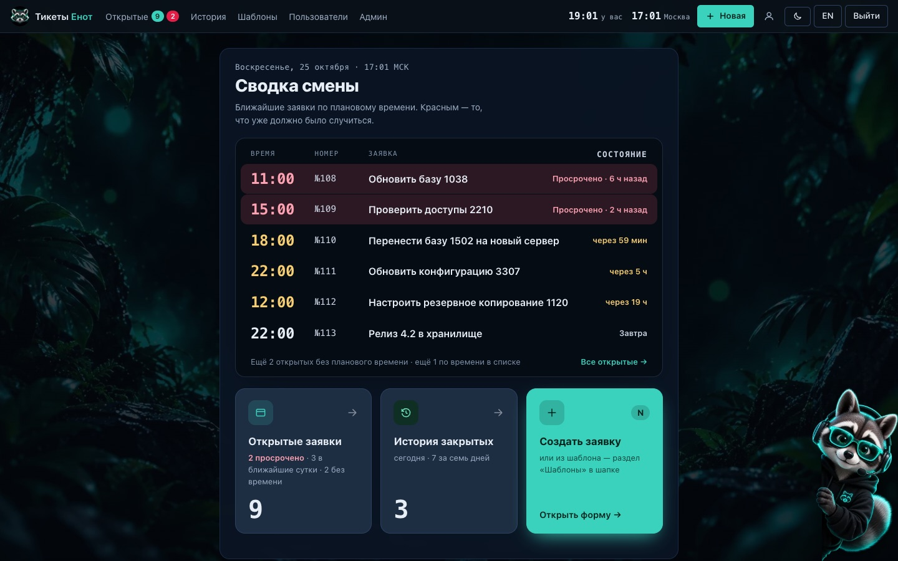
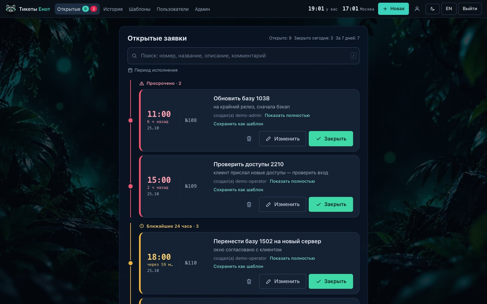
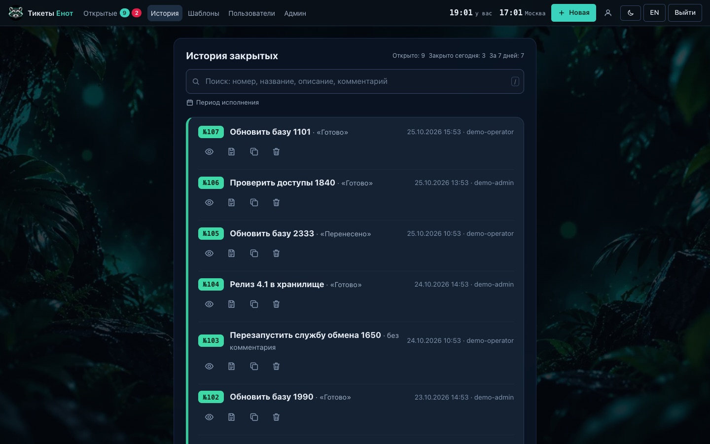
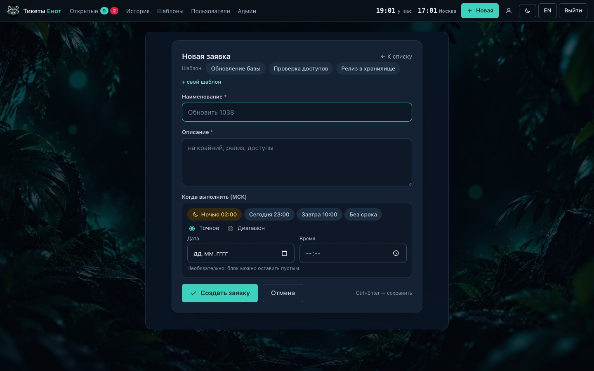
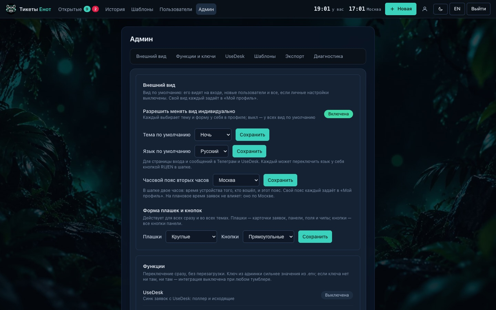
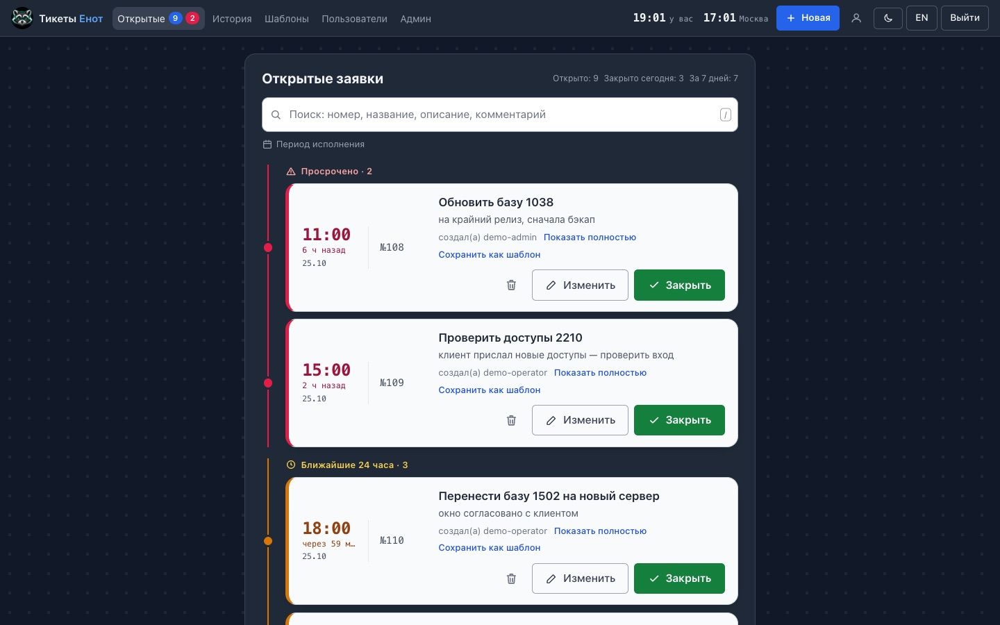
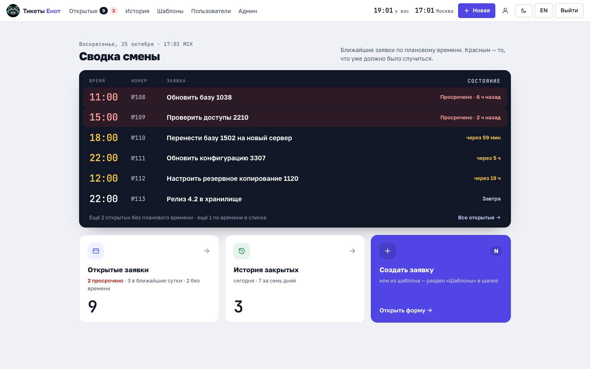
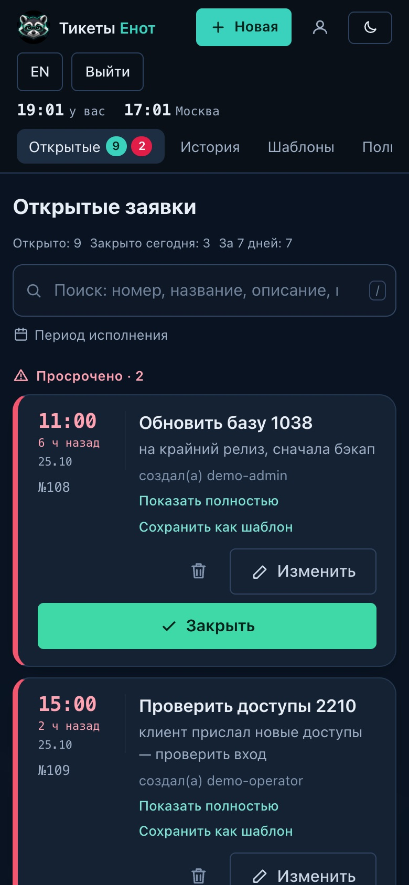
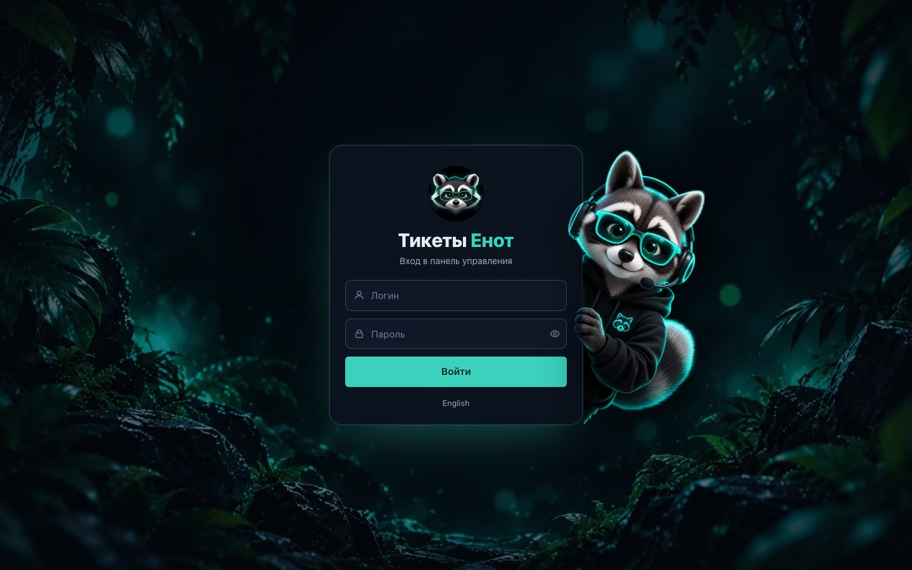

# Тикеты Енот: простая система заявок для службы поддержки

**Русский** · [English](README.en.md)

Тикеты Енот (Enot Tickets) — небольшая веб-панель заявок, которую ставят на свой сервер. Я делал её для команды поддержки, которая обновляет базы клиентов: оператор заводит заявку со сроком, панель показывает, что просрочено и что горит в ближайшие сутки, а закрытая заявка уходит в историю с комментарием. Новые и закрытые заявки дублируются в Телеграм-группу, а с хелпдеском [UseDesk](https://usedesk.ru) заявки синхронизируются в обе стороны.

Внутри Python (FastAPI), шаблоны Jinja2 с HTMX и одна база SQLite. Node.js, сборщик фронтенда и отдельный сервер базы данных не нужны. Интерфейс на русском и английском, язык переключается кнопкой RU/EN.



## Что умеет

- На главной «Сводка смены»: табло ближайших заявок по плановому времени, просроченные сверху, и счётчики открытых, просроченных и закрытых сегодня.
- Открытые заявки сами раскладываются по сроку: «Просрочено», «Ближайшие 24 часа», «Позже», «Без срока». В строке заявки первым идёт время крупными цифрами, под ним подсказка вроде «через 2 ч» или «5 ч назад».
- Закрытие в два клика: чипы «Готово» и «Перенесено» или свой комментарий.
- История закрытых с поиском по номеру, названию, описанию и комментарию. Поиск понимает русские окончания: «доступов» найдёт «доступы».
- Шаблоны типовых заявок, личные и общие. Пропуск в фигурных скобках, например `{база}`, выделяется после клика, и номер можно сразу печатать поверх.
- Роли «админ» и «оператор», смена пароля в профиле, деактивация пользователей.
- Три темы, «Ночь», «Классика» и «Табло», круглые или прямоугольные кнопки. В шапке двое часов: время устройства и выбранный часовой пояс (админ задаёт для всех, в профиле можно свой). У каждого свой вид, он хранится на сервере и одинаков на всех устройствах. Можно сделать [свою тему](docs/themes.md).
- Телеграм-бот пишет в группу о новых и закрытых заявках.
- Синхронизация с UseDesk: заявка из панели создаёт тикет, тикет из UseDesk становится заявкой, закрытие проходит в обе стороны.
- Экспорт в CSV (открывается в Excel) и JSON, импорт старого списка заявок из JSON.
- Работает на телефоне, планшете и больших мониторах. Горячие клавиши: `/` поиск, `N` новая заявка, `Ctrl+Enter` сохранить.

## Скриншоты

| Открытые заявки | История закрытых |
|---|---|
|  |  |
| **Новая заявка с шаблонами** | **Админка** |
|  |  |
| **Тема «Классика»** | **Тема «Табло»** |
|  |  |
| **Телефон** | **Вход** |
|  |  |

В шапке на скриншотах двое часов: первые показывают время устройства (у браузера стоял пояс Екатеринбурга), вторые — Москву. Все заявки выдуманные, их создаёт скрипт `scripts/demo_data.py`.

## Честно о текущей версии

Панель писалась под задачи одной небольшой команды и в этом объёме работает: 363 автотеста проходят, интеграции проверены на моках. Но это не Jira и не Zendesk, и у неё есть ограничения, о которых лучше знать заранее.

- **Сроки считаются по Москве (UTC+3).** Часовой пояс в настройках меняет только вторые часы в шапке. Плановое время, «просрочено», «сегодня» и время в истории по-прежнему идут по МСК, и чтобы считать их в другом поясе, придётся править код (`app/tickets.py`, `static/app.js`).
- **Один процесс и SQLite.** Рассчитано на команду до нескольких десятков человек. Горизонтально не масштабируется: два экземпляра на одну базу запускать нельзя ([ADR-0001](docs/adr/0001-sqlite-single-process.md)).
- **У заявки два статуса: открыта и закрыта.** Нет исполнителя, приоритета, вложений, переписки внутри заявки, SLA и отчётов.
- **Интеграция только с UseDesk и Телеграмом.** Почты нет. UseDesk опрашивается раз в минуту, вебхуков нет, поэтому изменения приходят с задержкой до минуты ([ADR-0002](docs/adr/0002-polling-not-webhooks.md)).
- **Вход только по логину и паролю.** Нет двухфакторной аутентификации и SSO. Счётчик неудачных попыток входа хранится в памяти и обнуляется при перезапуске.
- **Нет API.** Панелью пользуются через браузер, внешние системы могут забрать данные только экспортом CSV/JSON.
- **Перевод неполный в мелочах.** Интерфейс переведён весь, но журналы сервера, комментарии в коде и документы для разработчиков (`docs/architecture.md`, ADR) на русском. Поиск с учётом окончаний работает только для русских слов.
- **Тема прописана в нескольких местах.** Чтобы добавить ещё одну тему, её id надо внести в пять файлов ([как это сделать](docs/themes.md)).
- **Бэкап ручной:** это копия папки `data/`, по расписанию сама панель ничего не сохраняет.
- **Если потерян пароль единственного админа,** восстановить доступ можно только из бэкапа.

### Что дальше

Проект больше не развивается, эта версия последняя. Код открыт под лицензией [MIT](LICENSE): если панели чего-то не хватает, берите её за основу и дописывайте под себя. Меняйте и используйте как угодно, в том числе в коммерческих проектах, главное — сохраните файл лицензии. С чего начать, описано в разделе [«Для разработчиков»](#для-разработчиков).

## Попробовать на демо-данных

Нужен [uv](https://docs.astral.sh/uv/) (менеджер пакетов Python). Скрипт создаёт отдельную базу с выдуманными заявками, пользователей `demo-admin` и `demo-operator` и печатает пароль:

```bash
uv sync
DB_PATH=data/demo.sqlite uv run python scripts/demo_data.py --lang ru
```

```bash
DB_PATH=data/demo.sqlite uv run uvicorn app.main:app --port 8072
```

Откройте <http://127.0.0.1:8072> и войдите как `demo-admin`. Для английской версии запустите скрипт с `--lang en` на другом файле базы. В рабочую базу скрипт ничего не пишет: если в базе уже есть заявки, он откажется работать.

## Язык интерфейса

Кнопка RU/EN есть в шапке, на главной и на странице входа. Выбор запоминается в браузере, а у вошедшего пользователя ещё и в профиле, поэтому на другом устройстве язык включится сам после входа. Язык для страницы входа и для сообщений в Телеграм и UseDesk выбирает админ: **Админ → Внешний вид → Язык по умолчанию**.

Строки интерфейса пишутся в коде по-русски внутри `_()`, английский перевод лежит в `app/locales/en.json`. Тест `tests/test_i18n.py` проверяет, что у каждой строки есть перевод и что на английских страницах не осталось русского текста.

## Свои темы

Как перекрасить «Ночь», «Классику» или «Табло» и как добавить новую тему: [docs/themes.md](docs/themes.md).

---

## Быстрый старт (локально, ~10 минут)

> **Самый быстрый путь — [INSTALL.md](INSTALL.md): установка одной командой
> (`bash scripts/install.sh`, Docker или нативный режим — скрипт выберет сам) и
> сборка ZIP со всем нужным (`scripts/build-zip.sh`).** Ниже — ручная установка.

Нужен установленный и запущенный [Docker Desktop](https://www.docker.com/products/docker-desktop/).

1. Откройте терминал в папке проекта и создайте файл с настройками:

   ```
   cp .env.example .env
   ```

2. Откройте `.env` в любом текстовом редакторе и впишите **логин и пароль первого
   администратора** — это ваш вход в панель:

   ```
   ADMIN_LOGIN=admin
   ADMIN_PASSWORD=придумайте-надёжный-пароль
   ```

   Пароль не может быть длиннее **72 байт** — это технический предел хеширования
   bcrypt (кириллица занимает 2 байта на букву). Более длинный пароль панель не
   примет: в формах создания пользователя и смены пароля появится сообщение
   по-русски, а если слишком длинный пароль оказался в `ADMIN_PASSWORD`, панель
   всё равно запустится, но администратор создан не будет — в журнале
   (`docker compose logs app`) будет строка с объяснением; укоротите пароль
   в `.env` и перезапустите панель.

   Рядом впишите ключ сессий (любая длинная случайная строка; команда для его создания
   на Mac и Linux):

   ```
   openssl rand -base64 32
   ```

3. Соберите и запустите панель:

   ```
   docker compose up --build -d
   ```

   На Mac Docker-десктоп не нужен — используется colima: `brew install colima docker`,
   затем `colima start` (VM 2 CPU / 4 ГБ) и та же команда. На Linux — просто команда выше.
   Сборка ставит зависимости из uv.lock (--frozen): версии воспроизводимы байт-в-байт.

4. Дождитесь готовности панели (и импорта из JSON, если он задан) — посмотрите журнал:

   ```
   docker compose logs -f app
   ```

   Если задан `SEED_PATH`, строка **«Импортировано N, пропущено M (конфликты номеров: K; …)»** означает, что импорт завершён
   (`Ctrl+C` выходит из просмотра журнала, панель продолжает работать).

5. Откройте <http://127.0.0.1:8072> и войдите под логином и паролем из `.env`.

Панель полностью работает и **без остальных ключей**: без токенов интеграции просто
молча выключены, заявки и вся остальная панель работают как обычно.

---

## Шаблоны заявок: как создать и использовать

Шаблон — заготовка типовой заявки: кнопка на форме «Новая заявка» заполняет
заголовок и описание. Шаблоны делает **каждый** — оператор и админ — на странице
**Шаблоны** (вкладка в шапке). Там же короткая инструкция «Как сделать шаблон».

- **Личный** (по умолчанию) — видит и правит только автор; на форме помечен ★.
- **Для всех** — галочка «Показывать всем»: шаблон видят все, правит автор и админ.
- Шаблоны, сделанные админом, — общие (правит админ).
- Пропуск в фигурных скобках — `Обновить {база}` — после клика по шаблону
  выделяется, оператор сразу печатает номер базы поверх.
- **Из готовой заявки:** «Сохранить как шаблон» в карточке или строке истории —
  поля заполнятся сами, останется заменить номер на `{база}`.
- Кнопки шаблонов включаются сами, когда создан первый шаблон; выключить их
  для всех может админ: **Админ → Функции → Шаблоны заявок**. Пока шаблонов нет,
  админ может нажать **Админ → Шаблоны → Добавить примеры** (три общих).

---

## Как устроен экран заявок

- **Язык.** Кнопка RU/EN в шапке; язык по умолчанию — **Админ → Внешний вид**.
- **Темы.** «Ночь» (джунгли, енот, один акцент — бирюза; статус заявки показывают
  только полоска слева и чип), «Классика» (светлый строгий вид, акцент синий) и «Табло»
  (светлый рабочий вид: холодный фон, белые плашки, индиго, шрифты Golos Text и JetBrains Mono).
  Переключатель — в шапке; выбор хранится в профиле пользователя. Тему для новых посетителей выбирает админ: **Админ → Внешний вид**. Свою тему можно сделать по [инструкции](docs/themes.md).
- **Часы.** В шапке двое часов: время устройства и выбранный часовой пояс. На выбор
  27 городов (Россия, соседние страны и несколько крупных городов мира) и UTC. Пояс для всех задаёт админ в
  **Админ → Внешний вид**, по умолчанию Москва; свой можно выбрать в **Мой профиль**.
  Если пояс устройства совпадает с выбранным, первые часы прячутся; на экранах уже
  1280 px остаются только вторые. Часы только показывают время: сроки заявок
  считаются по Москве.
- **Форма плашек и кнопок.** «Круглые» или «Прямоугольные» отдельно для плашек
  (карточки, панели, поля, чипы) и для кнопок.
- **Мой профиль** (ссылка с логином в шапке, «Профиль» на главной) — у каждого свой:
  - смена пароля: текущий + новый дважды, новый не короче 8 символов; после смены
    на других устройствах нужно войти заново;
  - личный вид: тема, форма плашек/кнопок и пояс вторых часов. Хранится на сервере — одинаковый на ПК,
    планшете и телефоне. «Как у всех» возвращает вид по умолчанию.
- **Вид по умолчанию и запрет личного вида** — **Админ → Внешний вид**: тема и форма
  для входа и новых пользователей; тумблер «Разрешить менять вид индивидуально»
  (выключен — у всех вид по умолчанию, переключателя темы нет).
- **Админ:** меню разделов вверху; «Пользователи» — создать, сменить пароль,
  «Сделать админом / оператором», деактивировать и «Активировать» обратно
  (свою роль и последнего админа поменять нельзя); «Диагностика» — состояние синка:
  последний цикл поллера, последнее изменение из UseDesk, сколько ждут отправки,
  ошибки и текст последней.
- **Экраны:** телефон, планшет, ноутбук и большие мониторы (на 1600+ и 2200+ px
  шрифт и колонка крупнее). От 1024 px шапка помещается в одну строку: на ноутбуке
  логин и название темы сворачиваются в иконки.
- **Главная** — «Сводка смены». Сверху дата и время по МСК, под ними тёмное табло
  ближайших заявок по плановому времени: просроченные первыми и с пометкой
  «Просрочено · 42 мин назад», остальные с «через 48 мин», «Завтра» или датой.
  Ниже три плашки: открытые (сколько просрочено, сколько в ближайшие сутки, сколько без
  времени), закрытые сегодня и кнопка новой заявки.
- **Открытые** сгруппированы по сроку: «Просрочено» (красные),
  «Ближайшие 24 часа» (жёлтые), «Позже», «Без срока». Заявка занимает одну строку:
  слева крупно время по МСК, под ним «через 3 ч» / «5 ч назад» и дата, дальше номер,
  название с описанием и кнопки. Группы соединены вертикальной линией своего цвета.
  На телефоне строка складывается в две колонки, кнопки уходят вниз.
- **Закрыть** раскрывает комментарий: чипы «Готово» / «Перенесено» или свой текст.
  После действия сверху строка «Заявка №N закрыта».
- **История** — одна строка на заявку: комментарий, когда и кто закрыл,
  кнопки «Показать», «Повторить» (новая заявка с тем же текстом) и удаление.
  Группировку по дням включает тумблер **Админ → Функции → История по дням**.
- **Клавиши:** `/` — поиск (ищет сразу при наборе), `N` — новая заявка,
  `Ctrl+Enter` — сохранить форму.
- Картинки енота и фона (`static/raccoon-hero.webp`, `hero-bg.webp`,
  `raccoon-avatar.webp`, `favicon.png`) — от владельца, заменяются файлами с теми же именами.

---

## Где взять каждый ключ (файл `.env`)

| Ключ | Где взять |
|------|-----------|
| `ADMIN_LOGIN`, `ADMIN_PASSWORD` | Придумываете сами: вход первого администратора в панель |
| `PANEL_SECRET_KEY` | Любая длинная случайная строка: `openssl rand -base64 32`. Если пусто — панель работает, но после каждого перезапуска всех выбрасывает на повторный вход |
| `USEDESK_API_TOKEN` | В usedesk.ru: **Настройки → API**, скопируйте «секретный ключ» канала API |
| `TELEGRAM_BOT_TOKEN` | В Telegram у официального бота **@BotFather**: команда `/newbot`, придумайте имя и адрес бота — BotFather пришлёт токен вида `1234567890:AA...` |
| `TELEGRAM_CHAT_ID` | Номер вашей телеграм-группы — как узнать, см. ниже |

**Как узнать `TELEGRAM_CHAT_ID` группы:**

1. Добавьте созданного бота в вашу группу (лучше сразу сделайте его администратором
   группы, чтобы он точно видел сообщения).
2. Напишите в группу любое сообщение.
3. Откройте в браузере адрес (подставив **свой** токен бота вместо `ТОКЕН_БОТА`):

   ```
   https://api.telegram.org/botТОКЕН_БОТА/getUpdates
   ```

4. В ответе найдите фрагмент `"chat":{"id":-100...}` — это число и есть
   `TELEGRAM_CHAT_ID` (для групп оно с минусом). Впишите его в `.env`.
5. Если ответ пустой — напишите в группу ещё одно сообщение и обновите страницу.

После любых правок `.env` примените их:

```
docker compose up -d
```

**Проверка без риска:** в админке есть кнопки диагностики — «Тест UseDesk» и
«Тестовое сообщение» (телеграм). Каждая сразу показывает результат: «ок»
или текст ошибки. Перед переходом на сервер нажмите обе.

---

## Перенос на сервер

**Самый простой путь — с доменом и HTTPS одной командой** (подробно — `INSTALL.md`,
раздел «На хостинг»): `DOMAIN=tickets.example.ru bash scripts/install.sh`. Скрипт
поднимет панель и Caddy с автоматическим сертификатом Let's Encrypt. Ниже — ручной
вариант со своим nginx.

1. Установите Docker на сервер (официальный установщик: `curl -fsSL https://get.docker.com | sh`).
2. Скопируйте проект на сервер (папку `data/` не копируйте — на сервере база создастся
   заново (импорт из JSON выполнится, если он задан), а переехать с готовой базой можно обычной копией `data/`,
   см. «Бэкап»):

   ```
   rsync -av --exclude .venv --exclude .git --exclude data ./ user@АДРЕС-СЕРВЕРА:/opt/tikety/
   ```

3. На сервере заполните `.env` (те же ключи, что и локально) и запустите:

   ```
   cd /opt/tikety
   docker compose up -d --build
   ```

4. Панель поднимется, но порт по-прежнему открыт **только на самом сервере**
   (127.0.0.1:8072) — наружу её открывает nginx. Пример блока `location`:

   ```nginx
   location / {
       proxy_pass http://127.0.0.1:8072;
       proxy_set_header Host $host;
       proxy_set_header X-Forwarded-For $proxy_add_x_forwarded_for;
       proxy_set_header X-Forwarded-Proto $scheme;
   }
   ```

   **Рекомендация:** панель рассчитана на маленькую команду, а не на весь интернет.
   Прикройте её паролем на стороне nginx (`auth_basic`) и включите TLS
   (сертификат — через certbot/letsencrypt). Тогда чужой не увидит даже страницу входа.
   После включения HTTPS добавьте в `.env` строку `COOKIE_SECURE=1` — сессии получат
   флаг Secure (на локальном http-доступе этого делать нельзя — вход сломается).

---

## Импорт заявок из JSON

Если у вас уже есть список заявок (например, из таблицы или другой программы учёта),
панель может загрузить его сама. Файл — JSON-массив объектов
`{id, number, title, description, status, comment?, datetime?, closed_at?}`
(`datetime` — плановое время текстом, `closed_at` — дата закрытия в UTC). Положите его
в `seed/` и укажите путь в `.env`:

   ```
   SEED_PATH=seed/tickets.json
   ```

При первом старте с пустой базой панель импортирует файл автоматически. Повторный
импорт, например после дополнения файла:

   ```
   docker compose exec app /app/.venv/bin/python -m app.importer
   ```

   В ответе будет `Импортировано N, пропущено M (конфликты номеров: K, …)`.
   **Потери невозможны**: импорт добавляет только те заявки, которых ещё нет —
   сверка идёт по `id` из файла (он хранится отдельно, в `legacy_id`, и не пересекается
   с заявками, созданными самой панелью); существующие записи не перезаписываются.
   Прогнать импорт можно сколько угодно раз — дублей не будет.

   Единственный особый случай — **конфликт номеров**: если заявка с таким же номером
   уже есть в панели, строка из файла пропускается, номер попадает в журнал
   (`Конфликт номера при импорте…`) и в счётчик `K` — сверьте такие пары вручную.

---

## Бэкап

Вся база панели — это одна папка `data/` в проекте (файл `tickets.sqlite` и временные
`tickets.sqlite-wal`, `tickets.sqlite-shm`). **Бэкап = копия папки `data/`.**

Самый надёжный способ — на секунду остановить панель и скопировать:

```
docker compose stop app
cp -R data /путь/к/бэкапу/data-2026-10-12
docker compose start app
```

Восстановление: остановите панель, верните содержимое папки `data/` из бэкапа,
запустите (`docker compose start app`).

Два предупреждения о безопасности бэкапов:

- в базе лежат токены интеграций (UseDesk, телеграм-бот), вписанные через админку, —
  каждый бэкап их содержит; храните копии `data/` с тем же care, что и пароли,
  и ограничьте доступ к папке: `chmod 700 data`;
- если панель опубликована за nginx, оставьте `client_max_body_size 1m;` (дефолт) —
  это внешний предел размера форм сверх серверных отсечек панели.

---

## Что делать при проблемах

**Первое действие при любой странности — журнал панели:**

```
docker compose logs -f app
```

(`Ctrl+C` — выйти из просмотра; сами сообщения об ошибках панель пишет по-русски.)

| Симптом | Что делать |
|---------|------------|
| После перезапуска у всех слетел вход, просят логин заново | В `.env` пустой `PANEL_SECRET_KEY`. Впишите `openssl rand -base64 32`, затем `docker compose up -d` |
| «port is already allocated» / адрес уже занят | Что-то другое занимает порт 8072. Поменяйте левую часть в `docker-compose.yml`: `"127.0.0.1:8073:8000"` и `docker compose up -d` |
| На Linux при старте «Permission denied» на папку data | `sudo chown -R 1000:1000 data`, затем `docker compose up -d` |
| Забыт пароль администратора | Любой другой активный админ меняет его в разделе «Пользователи». Если админских доступов не осталось — верните папку `data/` из бэкапа (до потери пароля); повысить оператора до админа из панели нельзя — восстановление из бэкапа единственный путь |
| Панель не открывается после `up` | Подождите полминуты (первый старт создаёт базу) и проверьте `docker compose logs -f app`; статус — `docker compose ps` |
| Телеграм/UseDesk не приходят | Проверьте ключи в `.env` и нажмите кнопки «Тест» в админке — они покажут текст ошибки |

---

## Для разработчиков

```bash
uv sync
make check   # ruff + pytest, все тесты должны пройти
make run     # панель с автоперезагрузкой на http://127.0.0.1:8072
```

С чего начать чтение:

- [docs/architecture.md](docs/architecture.md): поток данных, границы модулей, инварианты;
- [docs/adr/](docs/adr/): почему SQLite, опрос вместо вебхуков, очередь синка и другие решения;
- [CONTEXT.md](CONTEXT.md): словарь предметной области (заявка и тикет UseDesk — разные вещи);
- `app/routes/` — HTTP-роуты, `app/tickets.py` — заявки, `app/sync.py` — синк и настройки, `app/i18n.py` — языки;
- `templates/` и `static/` — Jinja2, HTMX и CSS без сборки; темы описаны в [docs/themes.md](docs/themes.md).

Внешний HTTP в тестах не ходит: клиенты UseDesk и Телеграма подменяются `httpx.MockTransport`.

## Лицензия

[MIT](LICENSE) © 2026 Flint-sega
